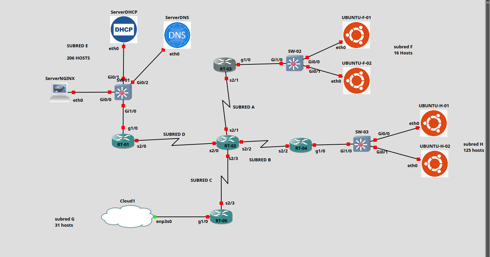

**Imágenes Docker ya configuradas:**

- [Servidor DHCP — archivo .tar](https://github.com/IsaiRamirez11/Escalabilidad_de_redes/tree/main/Resources/Containers/ServidoresDHCP)
- [Servidor DNS — archivo .tar](https://github.com/IsaiRamirez11/Escalabilidad_de_redes/tree/main/Resources/Containers/Servidores%20DNS)


## Direccionamiento VLSM

| Subred | Hosts | Red | Máscara | Gateway / uso |
|---|---:|---|---|---|
| E | 206 | 23.0.0.0/24 | 255.255.255.0 | RT-01: 23.0.0.254 |
| H | 125 | 23.0.1.0/25 | 255.255.255.128 | RT-04: 23.0.1.126 |
| G | 31 | 23.0.1.128/26 | 255.255.255.192 | RT-05: 23.0.1.190 |
| F | 16 | 23.0.1.192/27 | 255.255.255.224 | RT-03: 23.0.1.222 |
| A | 2 | 23.0.1.224/30 | 255.255.255.252 | RT-02 ↔ RT-03 |
| B | 2 | 23.0.1.228/30 | 255.255.255.252 | RT-02 ↔ RT-04 |
| C | 2 | 23.0.1.232/30 | 255.255.255.252 | RT-02 ↔ RT-05 |
| D | 2 | 23.0.1.236/30 | 255.255.255.252 | RT-01 ↔ RT-02 |

# conexiones:

|  |  |
|---|---|
| SW-01 Gig0/1 | ServerDHCP eth0 |
| SW-01 Gig0/0 | ServerNGINX eth0 |
| SW-01 Gig0/2 | ServerDNS eth0 |
| SW-01 Gig1/0 | RT-01 Gig1/0 |
| RT-01 ser2/0 | RT-02 ser2/0 |
| RT-02 ser2/1 | RT-03 ser2/1 |
| RT-03 gig1/0 | SW-2 Gig1/0 |
| SW-02 gig0/0 | UBUNTU-F-01 eth0 |
| SW-02 gig0/1 | UBUNTU-F-02 eth0 |
| RT-02 ser2/2 | RT-04 ser2/2 |
| RT-04 Gig1/0 | SW-03 Gig1/0 |
| SW-03 Gig0/0 | UBUNTU-H-01 eth0 |
| SW-03 Gig0/1 | UBUNTU-H-02 eth0 |
| RT-02 ser2/3 | RT-05 ser2/3 |
| RT-05 gig1/0 | Cloud1 enp3s0 |


## Routers


### RT-01

```
conf term
enable secret CiscoEnable
service password-encryption
banner motd #ACCESO RESTRINGIDO SOLO PERSONAL AUTORIZADO#
line console 0
password CiscoConsole
login
exit
interface Gig1/0
ip address 23.0.0.254 255.255.255.0
no shut
exit
interface Ser2/0
ip address 23.0.1.237 255.255.255.252
no shut
exit
router rip
version 2
no auto-summary
network 23.0.0.0
exit
ip domain-name networking.dev.mx
username ADMIN secret admin12345
username CISCO secret cisco12345
username AUX secret aux12345
crypto key generate rsa modulus 1024
ip ssh version 2
line vty 0 15
transport input ssh
login local
exit
end
wr
```


### RT-02

```
conf term
enable secret CiscoEnable
service password-encryption
banner motd #ACCESO RESTRINGIDO SOLO PERSONAL AUTORIZADO#
line console 0
password CiscoConsole
login
exit
interface Ser2/0
ip address 23.0.1.238 255.255.255.252
no shut
exit
interface Ser2/1
ip address 23.0.1.225 255.255.255.252
no shut
exit
interface Serl2/2
ip address 23.0.1.229 255.255.255.252
no shut
exit
interface Serl2/3
ip address 23.0.1.233 255.255.255.252
no shut
exit
router rip
version 2
no auto-summary
network 23.0.0.0
exit
ip domain-name networking.dev.mx
username ADMIN secret admin12345
username CISCO secret cisco12345
username AUX secret aux12345
crypto key generate rsa modulus 1024
ip ssh version 2
line vty 0 15
transport input ssh
login local
exit
end
wr
```


### RT-03

```
conf term
enable secret CiscoEnable
service password-encryption
banner motd #ACCESO RESTRINGIDO SOLO PERSONAL AUTORIZADO#
line console 0
password CiscoConsole
login
exit
interface Ser2/1
ip address 23.0.1.226 255.255.255.252
no shutdown
exit
interface Gig1/0
ip address 23.0.1.222 255.255.255.224
ip helper-address 23.0.0.1
no shutdown
exit
router rip
version 2
no auto-summary
network 23.0.0.0
exit
ip domain-name networking.dev.mx
username ADMIN secret admin12345
username CISCO secret cisco12345
username AUX secret aux12345
crypto key generate rsa modulus 1024
ip ssh version 2
line vty 0 15
transport input ssh
login local
exit
end
wr
```


### RT-04

```
conf term
enable secret CiscoEnable
service password-encryption
banner motd #ACCESO RESTRINGIDO SOLO PERSONAL AUTORIZADO#
line console 0
password CiscoConsole
login
exit
interface Ser2/2
ip address 23.0.1.230 255.255.255.252
no shutdown
exit
interface Gig1/0
ip address 23.0.1.126 255.255.255.128
ip helper-address 23.0.0.1
no shutdown
exit
router rip
version 2
no auto-summary
network 23.0.0.0
exit
ip domain-name networking.dev.mx
username ADMIN secret admin12345
username CISCO secret cisco12345
username AUX secret aux12345
crypto key generate rsa modulus 1024
ip ssh version 2
line vty 0 15
transport input ssh
login local
exit
end
wr
```


### RT-05

```
conf term
enable secret CiscoEnable
service password-encryption
banner motd #ACCESO RESTRINGIDO SOLO PERSONAL AUTORIZADO#
line console 0
password CiscoConsole
login
exit
interface Ser2/3
ip address 23.0.1.234 255.255.255.252
no shutdown
exit
interface Gig1/0
ip address 23.0.1.190 255.255.255.192
ip helper-address 23.0.0.1
no shutdown
exit
router rip
version 2
no auto-summary
network 23.0.0.0
exit
ip domain-name networking.dev.mx
username ADMIN secret admin12345
username CISCO secret cisco12345
username AUX secret aux12345
crypto key generate rsa modulus 1024
ip ssh version 2
line vty 0 15
transport input ssh
login local
exit
end
wr
```


## Switches


### SW-01

```
ena
conf term
enable secret CiscoEnable
service password-encryption
banner motd #ACCESO RESTRINGIDO SOLO PERSONAL AUTORIZADO#
line console 0
password CiscoConsole
login
exit
interface Vlan1
ip address 23.0.0.253 255.255.255.0
no shutdown
exit
ip default-gateway 23.0.0.254
ip domain-name networking.dev.mx
username ADMIN secret admin12345
username CISCO secret cisco12345
username AUX secret aux12345
crypto key generate rsa modulus 1024
ip ssh version 2
line vty 0 15
transport input ssh
login local
exit
end
wr
```


### SW-02

```
ena
conf term
enable secret CiscoEnable
service password-encryption
banner motd #ACCESO RESTRINGIDO SOLO PERSONAL AUTORIZADO#
line console 0
password CiscoConsole
login
exit
interface Vlan1
ip address 23.0.1.221 255.255.255.224
no shutdown
exit
ip default-gateway 23.0.1.222
ip domain-name networking.dev.mx
username ADMIN secret admin12345
username CISCO secret cisco12345
username AUX secret aux12345
crypto key generate rsa modulus 1024
ip ssh version 2
line vty 0 15
transport input ssh
login local
exit
end
wr
```


### SW-03

```
ena
conf term
enable secret CiscoEnable
service password-encryption
banner motd #ACCESO RESTRINGIDO SOLO PERSONAL AUTORIZADO#
line console 0
password CiscoConsole
login
exit
interface Vlan1
ip address 23.0.1.125 255.255.255.128
no shutdown
exit
ip default-gateway 23.0.1.126
ip domain-name networking.dev.mx
username ADMIN secret admin12345
username CISCO secret cisco12345
username AUX secret aux12345
crypto key generate rsa modulus 1024
ip ssh version 2
line vty 0 15
transport input ssh
login local
exit
end
wr
```


## ServerDHCP


### `/etc/dhcp/dhcpd.conf`

```conf
subnet 23.0.0.0 netmask 255.255.255.0
{
}

subnet 23.0.1.0 netmask 255.255.255.128
{
    range 23.0.1.1 23.0.1.124;
    option routers 23.0.1.126;
    option domain-name-servers 23.0.0.2;
    option domain-name "devops.com.mx";
    option broadcast-address 23.0.1.127;
    default-lease-time 600;
    max-lease-time 7200;
}

subnet 23.0.1.128 netmask 255.255.255.192
{
    range 23.0.1.129 23.0.1.189;
    option routers 23.0.1.190;
    option domain-name-servers 23.0.0.2;
    option domain-name "devops.com.mx";
    option broadcast-address 23.0.1.191;
    default-lease-time 600;
    max-lease-time 7200;
}

subnet 23.0.1.192 netmask 255.255.255.224
{
    range 23.0.1.193 23.0.1.220;
    option routers 23.0.1.222;
    option domain-name-servers 23.0.0.2;
    option domain-name "devops.com.mx";
    option broadcast-address 23.0.1.223;
    default-lease-time 600;
    max-lease-time 7200;
}
```


### `/etc/default/isc-dhcp-server`

```
INTERFACESv4="eth0"
INTERFACESv6=""
```


## ServerDNS


### `nano /etc/bind/named.conf.local`

```
zone "devops.com.mx" {
    type master;
    file "/etc/bind/db.devops.com.mx";
};

zone "0.23.in-addr.arpa" {
    type master;
    file "/etc/bind/rev.23.0";
};
```


### `nano /etc/bind/db.devops.com.mx`

```
$TTL 86400
@ IN SOA dns.devops.com.mx. root.devops.com.mx. (
    2026111003
    604800
    86400
    604800
    86400
)
@       IN NS dns.devops.com.mx.
@       IN A 23.0.0.3
dns     IN A 23.0.0.2
dns1    IN A 23.0.0.2
dhcp    IN A 23.0.0.1
nginx   IN A 23.0.0.3
www     IN A 23.0.0.3
www1    IN A 23.0.0.3
```


### `nano /etc/bind/rev.23.0`

```
$TTL 86400
@ IN SOA dns.devops.com.mx. root.devops.com.mx. (
    2026111003
    604800
    86400
    604800
    86400
)
@ IN NS dns.devops.com.mx.
1.0 IN PTR dhcp.devops.com.mx.
2.0 IN PTR dns.devops.com.mx.
3.0 IN PTR nginx.devops.com.mx.
```


### `nano /etc/bind/named.conf.options`

```
options {
    directory "/var/cache/bind";

    listen-on port 53 { 127.0.0.1; 23.0.0.2; };
    allow-query { 127.0.0.1; 23.0.0.0/8; };
    recursion yes;
    allow-recursion { 127.0.0.1; 23.0.0.0/8; };

    dnssec-validation auto;
    listen-on-v6 { none; };
};
```


### Permisos, validación e inicio de DNS

```
chown root:bind /etc/bind/db.devops.com.mx /etc/bind/rev.23.0
chmod 644 /etc/bind/db.devops.com.mx /etc/bind/rev.23.0
named-checkconf /etc/bind/named.conf
named-checkzone devops.com.mx /etc/bind/db.devops.com.mx
named-checkzone 0.23.in-addr.arpa /etc/bind/rev.23.0
```

```
rndc reload
```

## Pruebas desde los clientes Ubuntu

```
ping dns.devops.com.mx
ping dns1.devops.com.mx
ping dhcp.devops.com.mx
ping nginx.devops.com.mx
ping www.devops.com.mx
ping www1.devops.com.mx
```


