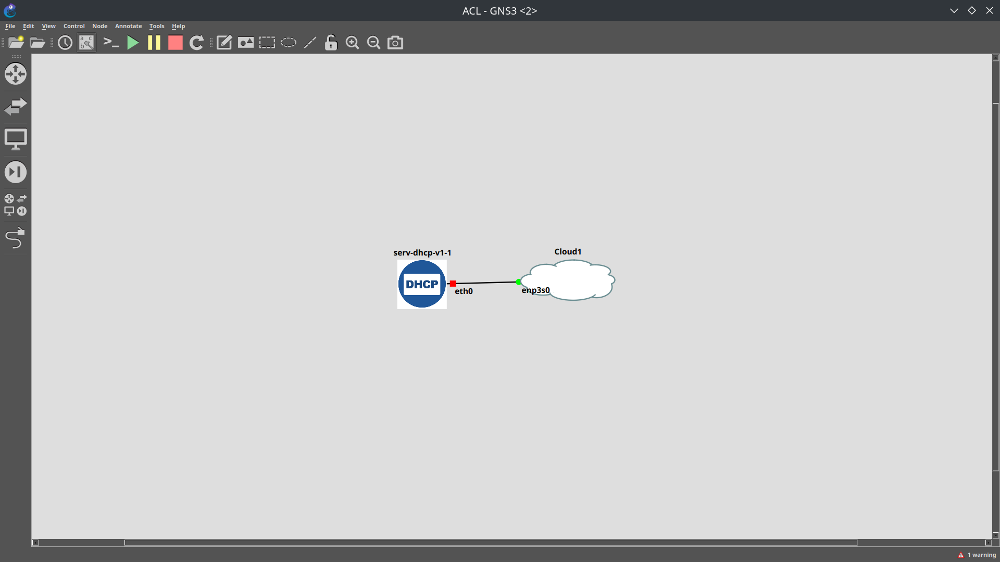

# Práctica: conexión de GNS3 con un Access Point TP-Link Omada AC1350

<p align="center">
  
</p>

<p align="center"><em></em></p>

## 1. Descripción

En esta práctica de **Escalabilidad de Redes** se conectó una topología de **GNS3** con un **punto de acceso físico TP-Link Omada AC1350**, utilizando un **contenedor con servidor DHCP** y un nodo **Cloud** de GNS3.



Una vez establecida la conexión, se utilizó **Fing** para identificar la dirección IP del punto de acceso. Para reconocerlo correctamente, se comparó la dirección MAC impresa en la etiqueta física del TP-Link con las direcciones MAC mostradas por la herramienta de descubrimiento de red. Con la IP identificada, se accedió a la interfaz web de administración del AP, donde se crearon las redes inalámbricas y se importó la configuración correspondiente.


**Recursos del repositorio:**

- [Contenedor DHCP — `Resources/Containers/ServidoresDHCP`](https://github.com/IsaiRamirez11/Escalabilidad_de_redes/tree/main/Resources/Containers/ServidoresDHCP)
- [Paquetes y herramientas — `Resources/Tools`](https://github.com/IsaiRamirez11/Escalabilidad_de_redes/tree/main/Resources/Tools)

## 4. Topología utilizada

```text
┌────────────────────────── GNS3 ──────────────────────────┐
│                                                         │
│  ┌───────────────────────┐    ┌─────────────────────┐   │
│  │ Contenedor con DHCP   │────│ Cloud de GNS3      │   │
│  └───────────────────────┘    └──────────┬──────────┘   │
│                                         │               │
└─────────────────────────────────────────┼───────────────┘
                                          │ Interfaz física
                                          │ / conexión Ethernet
                                 ┌────────▼─────────────┐
                                 │ TP-Link Omada AC1350│
                                 │ Access Point físico │
                                 └────────┬─────────────┘
                                          │
                                Panel de administración
                                y redes inalámbricas
```


 Integrar el contenedor DHCP en GNS3


1. Incorporar el contenedor DHCP disponible en el [repositorio de servidores DHCP](https://github.com/IsaiRamirez11/Escalabilidad_de_redes/tree/main/Resources/Containers/ServidoresDHCP).
2. Utilizar el contenedor como parte de la topología que se conectaría al AP físico.

La configuración de direccionamiento usada como referencia se muestra en la sección **6. Configuración DHCP**.

### Paso 2. Conectar el contenedor, la Cloud y el TP-Link

1. Agregar el nodo **Cloud** al proyecto de GNS3.
2. Asociar la Cloud con la interfaz de red física del anfitrión que permite alcanzar el TP-Link.
3. Conectar el contenedor DHCP con la Cloud dentro de GNS3.
4. Mantener el TP-Link conectado a la red física correspondiente.

### Paso 3. Instalar Fing y Overlook Fing desde la terminal

Los archivos de instalación se encuentran referenciados en [**`Resources/Tools`**](https://github.com/IsaiRamirez11/Escalabilidad_de_redes/tree/main/Resources/Tools).

Los siguientes comandos corresponden a distribuciones **Debian, Ubuntu, Kali Linux o Linux Mint**, y se ejecutan en la **terminal del equipo Linux donde se utilizarán las herramientas**, no dentro del contenedor DHCP.

**A. Obtener el repositorio y entrar a la carpeta correcta:**

```bash
cd ~
git clone https://github.com/IsaiRamirez11/Escalabilidad_de_redes.git
cd ~/Escalabilidad_de_redes/Resources/Tools
```

 Si ya se descargó el repositorio, se omite `git clone` y se utiliza `cd` para entrar a la carpeta `Resources/Tools` en la ubicación donde realmente se guardó. Por ejemplo: `cd ~/Descargas/Escalabilidad_de_redes/Resources/Tools`.

**B. Verificar los paquetes disponibles en esa carpeta:**

```bash
ls -lh *.deb
```

**C. Instalar los paquetes desde la carpeta actual:**

```bash
sudo apt update
sudo apt install ./fing_2.2_amd64.deb
sudo apt install ./overlook-fing-2.2.0.deb
```


**D. Consultar la instalación y la ayuda de Fing:**

```bash
dpkg -l | grep -i fing
fing --help
```

### Paso 4. Identificar la dirección IP del TP-Link mediante su MAC

1. Revisar la **etiqueta física** del TP-Link y localizar su dirección **MAC**.
2. Abrir **Fing** para consultar los dispositivos detectados en la red.
3. Comparar la dirección MAC de los dispositivos encontrados con la MAC impresa en la etiqueta del punto de acceso.
4. Identificar la **dirección IPv4** asociada a la coincidencia.

| Dato | Cómo se obtuvo |
| --- | --- |
| MAC del TP-Link | Etiqueta física del equipo. |
| MAC encontrada en la red | Resultado de Fing. |
| Dirección IP del TP-Link | Dirección asociada a la MAC coincidente en Fing. |

 No se registra una IP específica porque depende de la asignación y configuración de la red usada en la práctica. La coincidencia de las direcciones MAC fue el criterio empleado para reconocer el dispositivo correcto.

### Paso 5. Acceder al panel web y configurar las redes

1. Abrir un navegador en un equipo con conectividad hacia el AP.
2. Escribir la IP identificada en Fing; por ejemplo: `http://IP_DEL_TP_LINK` 
3. Ingresar al panel de administración del TP-Link con las credenciales autorizadas.
4. Desde el panel, **crear las redes inalámbricas** que se establecieron durante la práctica.
5. **Importar o aplicar la configuración** correspondiente desde el propio panel, de acuerdo con las opciones utilizadas en clase.

La cantidad de redes, sus nombres (**SSID**), sus contraseñas y los valores específicos del panel no se inventan en este documento porque no se proporcionaron.

## 6. Configuración DHCP

En el contenedor, el archivo de configuración del servicio DHCP es:

```bash
nano /etc/dhcp/dhcpd.conf
```


### 6.1. Ejemplo de referencia: red `192.168.34.0/24`

```conf
subnet 192.168.34.0 netmask 255.255.255.0 {
    range 192.168.34.2 192.168.34.10;
    option routers 192.168.34.254;
    option domain-name-servers 1.1.1.1;
    option domain-name "networking.mx";
    option broadcast-address 192.168.34.255;
    default-lease-time 600;
    max-lease-time 7200;
}
```


Después de guardar la configuración correspondiente, el comando indicado en clase para iniciar el servicio fue:

```bash
service isc-dhcp-server start
```


