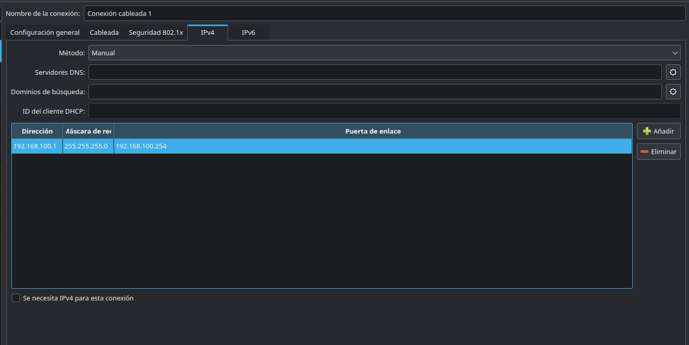
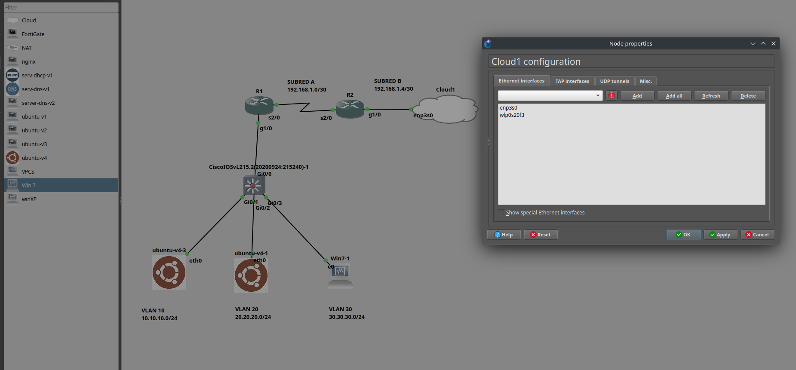
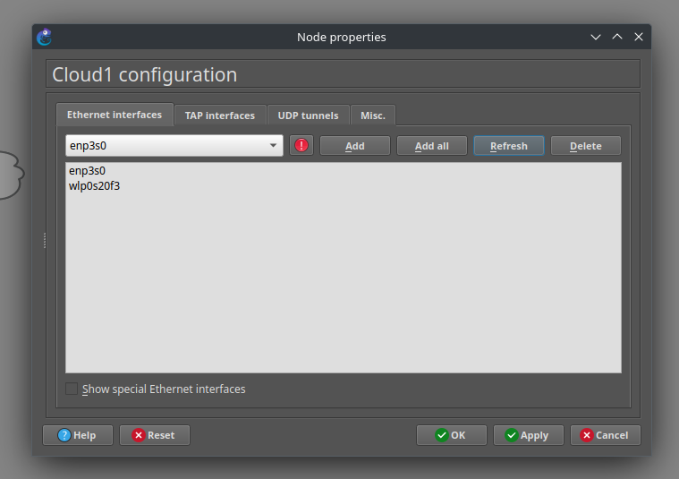
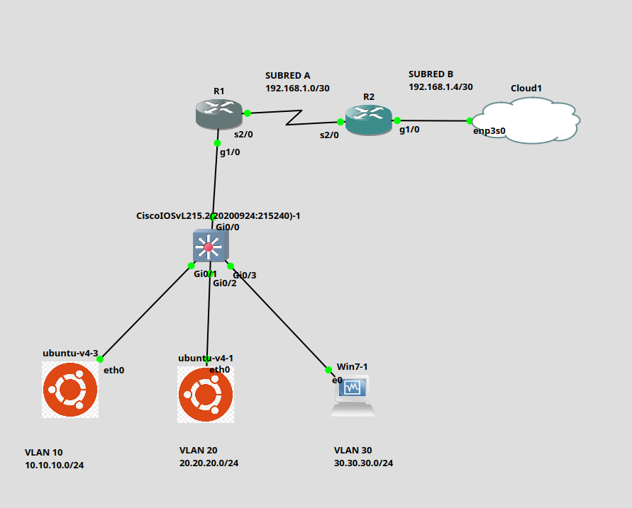
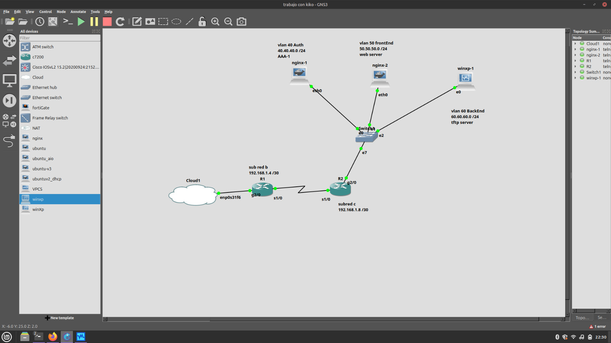

# Practica conexion multiusuario

## Recursos: 
### contenedores : https://github.com/IsaiRamirez11/Escalabilidad_de_redes/tree/main/Resources/Containers
### drivers para windows XP : https://github.com/IsaiRamirez11/Escalabilidad_de_redes/tree/main/Resources/Drivers%20/Win%20XP

## Configuracion de el adaptadores ethernet fisico  
### es especialmente necesario configurar para que evitemos esta intermitencia de encendidio y apagado de nuestro adaptador al no asignarse una ip, por lo que nosotros se la definimos manualmente como se muestra para la PC 1 seria la siguiente 
### Ejemplo para la PC 1:



### Como podemos ver le definimos la IP la mascara y la gateway manuamlente en este ejemplo definimos
### IP 

```
192.168.100.1
```

### Mascara  

```
255.255.255.0
```

### puerta de enlace o gateway

```
192.168.100.254
```
### Sinembargo se pueden definir IPS aleatorias siempre y cuando coincidan con el de la PC 2 para la PC 2 en este ejemplo definimos manuamlente tambien 


### Como podemos ver le definimos la IP la mascara y la gateway manuamlente en este ejemplo definimos
### IP 

```
192.168.100.2
```

### Mascara  

```
255.255.255.0
```

### puerta de enlace o gateway

```
192.168.100.254
```

### como podemos observar es la misma red solo cambian en el 4 octeto lo que nos da una convergencia entre adaptadores fisicos por lo tanto los adaptadores fisicos no estan encendiendo y apagando 


## Configuracion de Cloud 
### Esta configuracion es para poder conectarnos mediante un cable ethernet entre computadoras ya sea con adaptador nativo o algun adaptador de tipo c a ethernet 

## 1 - verificar si cloud reconoce el adaptador


### En mi caso es el adaptador enp3s0 y me aparece sinembargo si no nos aparece algun otro que no sea el wlp0s20f3 este adaptador es el wifi que en esta practica no lo usamos, debemos dar en el boton refresh 
## Topologia segmento A



### Una vez que nos aparezca lo seleccionamos en ok y despues en apply una vez teniendo esto ya podeos conectarnos a travez de un cable ethernet de un router a cloud lo que nos dara convergencia entre los dos segmentos 

### Reccordemos que a pezar de que estamos conectando routers que deberian ser con cables seriales Cloud no acepta serial por lo que usamos un cable ethernet

# Topologia segmento A PC 1





## Configuracion

### Switch

```
enable
configure terminal
vlan 10
vlan 20
vlan 30
exit
interface gi0/0
switchport trunk encapsulation dot1q
switchport mode trunk
switchport trunk allowed vlan 10,20,30
no shutdown
exit
interface gi0/1
switchport mode access
switchport access vlan 10
no shutdown
exit
interface gi0/2
switchport mode access
switchport access vlan 20
no shutdown
exit
interface gi0/3
switchport mode access
switchport access vlan 30
no shutdown
end
copy run start
```

### R1

```
enable
configure terminal
enable secret cisco123
interface g1/0
no shutdown
exit
interface g1/0.10
encapsulation dot1Q 10
ip address 10.10.10.254 255.255.255.0
exit
interface g1/0.20
encapsulation dot1Q 20
ip address 20.20.20.254 255.255.255.0
exit
interface g1/0.30
encapsulation dot1Q 30
ip address 30.30.30.254 255.255.255.0
exit
interface ser2/0
ip address 192.168.1.1 255.255.255.252
clock rate 640000
no shutdown
exit
router ospf 1
network 192.168.1.0 0.0.0.3 area 0
network 10.10.10.0 0.0.0.255 area 0
network 20.20.20.0 0.0.0.255 area 0
network 30.30.30.0 0.0.0.255 area 0
exit
ip domain-name cisco.mx
username admin secret admin123
crypto key generate rsa modulus 1024
ip ssh version 2
line vty 0 15
login local
transport input ssh
end
write memory
```

### R2

```
enable
configure terminal
enable secret cisco123
interface gig1/0
ip address 192.168.1.5 255.255.255.252
no shutdown
exit
interface ser2/0
ip address 192.168.1.2 255.255.255.252
no shutdown
exit
router ospf 1
network 192.168.1.0 0.0.0.3 area 0
network 192.168.1.4 0.0.0.3 area 0
exit
ip domain-name cisco.mx
username admin secret admin123
crypto key generate rsa modulus 1024
ip ssh version 2
line vty 0 15
login local
transport input ssh
end
write memory
```

### contenedor ubuntu vlan 10


```
auto eth0
iface eth0 inet static
	address 10.10.10.1
	netmask 255.255.255.0
	gateway 10.10.10.254
```

contenedor ubuntu vlan 20


```
auto eth0
iface eth0 inet static
	address 20.20.20.1
	netmask 255.255.255.0
	gateway 20.20.20.254
```

### Win7-1 vlan 30

Se configura a mano en Propiedades de TCP/IPv4:

```
IP:      30.30.30.1
Máscara: 255.255.255.0
Gateway: 30.30.30.254
```


# Topologia segmento B PC 2




## Configuración

### SW como el del segmento A

```
ena
conf term
vlan 40
vlan 50
vlan 60
exit

interface gi0/0
switchport trunk encapsulation dot1q
switchport mode trunk
switchport trunk allowed vlan 40,50,60
no shutdown
exit

interface gi0/1
switchport mode access
switchport access vlan 40
no shutdown
exit

interface gi0/2
switchport mode access
switchport access vlan 50
no shutdown
exit

interface gi0/3
switchport mode access
switchport access vlan 60
no shutdown
end
copy run start
```

### sw en caso de ser configurado por interfaz grafica como el de la imagen


| Port | VLAN | Type |
|---|---|---|
| 0 | 40 | access |
| 1 | 50 | access |
| 2 | 60 | access |
| 7 | 1 | dot1q |


### R2

```
conf term
enable secret cisco123
interface g2/0
no shutdown
exit

interface g2/0.40
encapsulation dot1Q 40
ip address 40.40.40.254 255.255.255.0
exit

interface g2/0.50
encapsulation dot1Q 50
ip address 50.50.50.254 255.255.255.0
exit

interface g2/0.60
encapsulation dot1Q 60
ip address 60.60.60.254 255.255.255.0
exit

interface ser1/0
ip add 192.168.1.10 255.255.255.252
no shut
exit

router ospf 1
network 192.168.1.8 0.0.0.3 area 0
network 40.40.40.0 0.0.0.255 area 0
network 50.50.50.0 0.0.0.255 area 0
network 60.60.60.0 0.0.0.255 area 0
exit

ip domain-name cisco.mx
username admin secret admin123
crypto key generate rsa modul 1024
ip ssh ver 2
line vty 0 15
login local
transport input ssh
do wr
```

### R1

```
conf term
enable secret cisco123
interface g2/0
ip add 192.168.1.6 255.255.255.252
no shut
exit

interface ser1/0
ip add 192.168.1.9 255.255.255.252
no shut
clock rate 640000
exit

router ospf 1
network 192.168.1.4 0.0.0.3 area 0
network 192.168.1.8 0.0.0.3 area 0
exit

ip domain-name cisco.mx
username admin secret admin123
crypto key generate rsa modul 1024
ip ssh ver 2
line vty 0 15
login local
transport input ssh
do wr
```

### nginx-1 VLAN 40


```
auto eth0
iface eth0 inet static
	address 40.40.40.1
	netmask 255.255.255.0
	gateway 40.40.40.254
```

### nginx-2 VLAN 50


```
auto eth0
iface eth0 inet static
	address 50.50.50.1
	netmask 255.255.255.0
	gateway 50.50.50.254
```

### winxp-1 o win 7 VLAN 60

Se configura a mano en Propiedades de TCP/IP:

```
IP:      60.60.60.1
Mascara: 255.255.255.0
Gateway: 60.60.60.254
```

## Pruebas para ver convergencia desde la VLAN 10 

### ping a la puerta de enlace de la vlan 20
```
ping 20.20.20.254
```
### ping al contenedor cliente de la vlan 20
```
ping 20.20.20.1
```
### ping a la puerta de enlace de la vlan 30
```
ping 30.30.30.254
```
### ping al contenedor cliente de la vlan 30
```
ping 30.30.30.1
```

